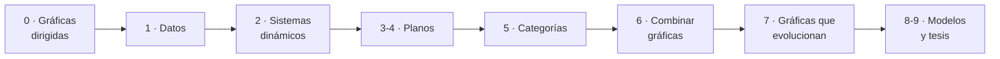

<div align="center">

# 🌌 NeoJulia

### Libretas interactivas de matemáticas con Julia y Pluto

*Dibuja, mueve, rompe y reconstruye las ideas. Todo se recalcula al instante.*

<br>

[](https://julialang.org)
[](https://github.com/fonsp/Pluto.jl)
[](https://navanibautista.github.io/NeoJulia/)
[](#)

<br>

### [📖 &nbsp;Abrir *Pensar en relaciones*&nbsp; →](https://navanibautista.github.io/NeoJulia/pensar_en_relaciones.html)

</div>

<br>

---

## ℹ️ Info

> [!NOTE]
> **NeoJulia** reúne libretas de matemáticas escritas para leerse *y* para tocarse: cada una es un solo archivo `.jl` que se abre con Pluto.

| | |
|:--|:--|
| 🧩 **Lenguaje** | [Julia](https://julialang.org) |
| 🪐 **Entorno** | [Pluto.jl](https://github.com/fonsp/Pluto.jl) (libretas reactivas) |
| 📓 **Archivo** | `pensar_en_relaciones.jl` · ≈ 330 KB · 5 104 líneas · 306 celdas |
| 📖 **Contenido** | Capítulos 0 a 9 y tres apéndices, basados en *Relational Thinking* (capítulos 0 a 8) |
| 🌎 **Idioma** | Español, con la terminología de los cursos de matemáticas en México (*gráfica*, *vértice*, *flecha*, *lazo*, *funtor*) |
| 📦 **Paquetes extra** | Ninguno: no hay nada que instalar |
| 🛠️ **Para ejecutarla** | Julia y Pluto instalados en tu computadora |
| 🌐 **Lectura en línea** | [GitHub Pages](https://navanibautista.github.io/NeoJulia/) |
| 🔗 **Repositorio** | <https://github.com/NavaniBautista/NeoJulia> |
| 🔄 **Actualización** | Automática con GitHub Actions en cada cambio al repositorio |

---

## 📓 Libretas

<table>
<tr>
<td width="72" align="center"><h1>🕸️</h1></td>
<td>

### Pensar en relaciones
`pensar_en_relaciones.jl`

Un recorrido interactivo, en español, por el **pensamiento relacional**: empieza con gráficas dirigidas dibujadas a mano y llega hasta categorías, funtores y la reescritura de gráficas. Sigue de cerca los capítulos 0 a 8 del libro *Relational Thinking*, con definiciones, teoremas, rompecabezas y preguntas para pensar, todo escrito como en un libro de matemáticas.

</td>
</tr>
</table>

### ✨ Qué hace especial a esta libreta

| | |
|:--|:--|
| 🖱️ **Interactiva** | Editor para dibujar gráficas con el ratón, deslizadores y preguntas que se corrigen solas |
| 🧮 **Código = matemáticas** | Las celdas de Julia son la traducción directa de las definiciones |
| 📚 **Estilo de libro** | Definiciones, proposiciones, demostraciones (∎), ejemplos y rompecabezas |
| 🧭 **Navegable** | Índice clicable al inicio y glosario al final |
| ⚡ **Ligera** | No se instalan paquetes y las animaciones se pausan fuera de pantalla |

### 🗺️ Ruta de aprendizaje



<details>
<summary><b>📑 Ver el índice completo de capítulos</b></summary>

<br>

| Capítulo | Tema |
|:--:|:--|
| **0** | Gráficas dirigidas |
| **1** | Datos |
| **2** | Sistemas dinámicos con Kiki y Bouba |
| **3 – 4** | Planos (I y II) |
| **5** | Categorías |
| **6** | Combinar gráficas |
| **7** | Gráficas que evolucionan |
| **8** | Una mirada más allá: modelos del mundo que evolucionan |
| **9** | Nivel tesis: componer sistemas dinámicos |
| **A · B · C** | Glosario, referencias y «Detrás del telón» |

</details>

---

## 🚀 Cómo entrar

### 🌐 Opción 1 · Leer en el navegador
*Sin instalar nada.*

> 👉 **<https://navanibautista.github.io/NeoJulia/pensar_en_relaciones.html>**
>
> Índice de todas las libretas: <https://navanibautista.github.io/NeoJulia/>

> [!NOTE]
> Esta versión es una exportación estática: sirve para leer y ver las figuras. Para cambiar el código y que todo se recalcule, usa la opción 2.

### 💻 Opción 2 · Ejecutar en tu computadora
*Totalmente interactiva.*

**1.** Instala [Julia](https://julialang.org/downloads/).

**2.** Descarga el repositorio:

```bash
git clone https://github.com/NavaniBautista/NeoJulia.git
cd NeoJulia
```

**3.** Abre Julia y ejecuta:

```julia
import Pluto
Pluto.run(notebook = "pensar_en_relaciones.jl")
```

La libreta se abrirá en tu navegador. La primera vez, Pluto instalará solo lo que necesite.

<details>
<summary><b>¿No tienes Pluto instalado?</b></summary>

<br>

Dentro de Julia escribe `]` para entrar al modo de paquetes y luego:

```julia
add Pluto
```

</details>

---

## 🗂️ Contenido del repositorio

| Archivo | Descripción |
|:--|:--|
| 📓 `pensar_en_relaciones.jl` | Libreta interactiva sobre gráficas, categorías y reescritura |
| 📄 `README.md` | Este archivo |

Las libretas se convierten automáticamente a HTML con **GitHub Actions** y se publican en **GitHub Pages** cada vez que se actualiza el repositorio.

---

<div align="center">

Hecho con 💜 y Julia por [@NavaniBautista](https://github.com/NavaniBautista)

</div>
